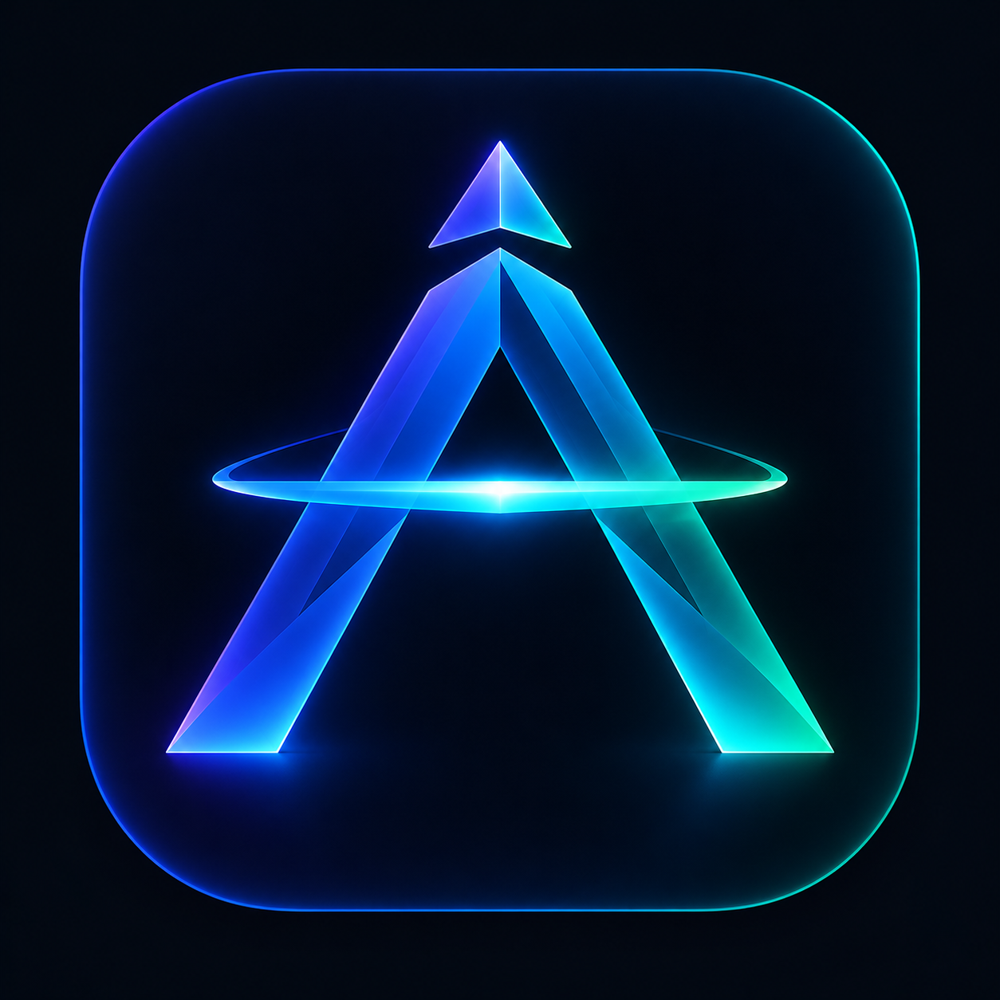

# AXIS — Personal Operating System for Discipline & Focus

<p align="center">
  
</p>

<p align="center">
  <strong>Unified Offline-First Productivity Suite, Habit Matrix & Mission Control for Mobile & Desktop</strong>
</p>

<p align="center">
  
  
  
  
  
  
</p>

---

## 📑 Table of Contents
1. [Overview & Philosophy](#-overview--philosophy)
2. [How Axis Works](#-how-axis-works)
3. [Full Architecture](#-full-architecture)
4. [Full Feature Spectrum](#-full-feature-spectrum)
5. [Installation & Setup](#-installation--setup)
   - [Prerequisites](#prerequisites)
   - [Environment Configuration](#environment-configuration)
   - [Mobile Installation (Android / iOS)](#mobile-installation-android--ios)
   - [Desktop Installation (Windows / macOS / Linux)](#desktop-installation-windows--macos--linux)
   - [Windows MSIX Packaging](#windows-msix-packaging)
6. [Testing & Quality Assurance](#-testing--quality-assurance)
7. [Directory Structure](#-directory-structure)
8. [License](#-license)

---

## ⚡ Overview & Philosophy

**Axis** is an offline-first personal productivity and discipline operating system. Engineered to bridge the gap between high-speed mobile task capture and wide-canvas desktop command stations, Axis provides a unified platform for task execution, habit building, prayer telemetry, deep work focus, and markdown journaling.

### The Core Cadence
Axis structures every day around a five-phase disciplined operating rhythm:

```
[ CAPTURE ] ──> [ PLAN ] ──> [ FOCUS ] ──> [ REVIEW ] ──> [ REFLECT ]
 Natural Lang    Priority     Pomodoro      Checklist       Markdown
 Quick-Add       Matrix       Soundscapes   & XP Award      Journaling
```

* **Capture:** Zero-friction input via natural language parser or desktop Omnibar (`Ctrl + K`).
* **Plan:** Priority matrix (P1 High, P2 Medium, P3 Normal), project clustering, and auto-scheduling.
* **Focus:** Fullscreen Zen timer with ambient noise soundscapes and attached task contexts.
* **Review:** Real-time checklist verification, streak calculations, and deterministic XP awards.
* **Reflect:** Daily journal debriefs, mood and energy telemetry, and long-term milestone tracking.

---

## 🔄 How Axis Works

### 1. Offline-First Data Replication
Axis operates with a local SQLite database at its heart:
- **Instant Writes:** Every user action (creating a task, toggling a prayer, logging a focus session) writes directly to local SQLite on the device with **zero latency** (<1 ms).
- **Background Streaming Sync:** The [PowerSync](https://www.powersync.com/) client syncs changes over a persistent WebSocket connection to [Supabase (PostgreSQL)](https://supabase.com/).
- **Conflict Resolution:** Deterministic row IDs (SHA-256) and UTC timestamp reconciliation ensure safe bi-directional synchronization without data loss.
- **Offline Resilience:** The app operates with 100% functionality without internet. Queued changes stream to the cloud automatically upon reconnection.

### 2. High-Performance Pagination (`LIMIT` & `OFFSET`)
Repositories implement lazy, paged queries (`watchTasks`, `watchNotes`, `getTasks`, `getNotes`) supporting massive user datasets (benchmarked up to **1,000,000 tasks** and **1,000,000 notes**) without consuming mobile heap memory or causing Out-Of-Memory (OOM) crashes.

### 3. Adaptive Responsive UI
Axis uses a single unified Flutter codebase with reactive viewport breakpoints:
- **Compact Viewport (< 900px):** Mobile layout featuring one-thumb navigation, bottom tab bar, swipe gestures, and native floating action sheets.
- **Expanded Viewport (≥ 900px):** Desktop Command Center featuring a collapsible navigation rail, high-density kanban columns, 3-column note vault, and floating dialogs.

---

## 🏗️ Full Architecture

```
┌────────────────────────────────────────────────────────────────────────┐
│                        PRESENTATION LAYER (UI)                         │
│  ┌──────────────────────────────┐    ┌──────────────────────────────┐  │
│  │     Mobile Layout (<900px)   │    │   Desktop Command Center     │  │
│  │ Bottom Navigation, Sheets,   │    │ Sidebar Rail, Omnibar        │  │
│  │ Mobile Today Matrix & Tabs   │    │ Kanban Deck, Note Inspector  │  │
│  └──────────────┬───────────────┘    └──────────────┬───────────────┘  │
│                 └──────────────────┬────────────────┘                  │
│                                    ▼                                   │
│                     State Management (BLoC / Cubits)                   │
│             AuthBloc  •  TasksBloc  •  FocusCubit  •  LocaleCubit      │
└────────────────────────────────────┬───────────────────────────────────┘
                                     │
┌────────────────────────────────────▼───────────────────────────────────┐
│                          DOMAIN LAYER (ENGINES)                        │
│  ┌───────────────────────┐ ┌───────────────────────┐ ┌───────────────┐ │
│  │   QuickAddParser      │ │   AutoScheduler       │ │ StreakEngine  │ │
│  │   (Natural Language)  │ │   (Time Blocking)     │ │ (Freeze/Logs) │ │
│  └───────────────────────┘ └───────────────────────┘ └───────────────┘ │
│  ┌───────────────────────┐ ┌───────────────────────┐ ┌───────────────┐ │
│  │   RecurrenceEngine    │ │  GamificationEngine   │ │  IdGenerator  │ │
│  │   (RFC 5545 RRULE)    │ │  (Deterministic XP)   │ │  (Idempotent) │ │
│  └───────────────────────┘ └───────────────────────┘ └───────────────┘ │
└────────────────────────────────────┬───────────────────────────────────┘
                                     │
┌────────────────────────────────────▼───────────────────────────────────┐
│                            DATA LAYER                                  │
│  ┌──────────────────────────────────────────────────────────────────┐  │
│  │                      Repository Abstractions                     │  │
│  │  TaskRepo • NoteRepo • HabitRepo • FriendRepo • ProjectRepo      │  │
│  │  (Equipped with LIMIT & OFFSET pagination, Stream caching)       │  │
│  └──────────────────────────────────┬───────────────────────────────┘  │
│                                     ▼                                  │
│  ┌──────────────────────────────────────────────────────────────────┐  │
│  │                   Local SQLite Database (PowerSync)              │  │
│  │   Indexed tables: tasks, notes, habits, habit_logs, profiles     │  │
│  └──────────────────────────────────┬───────────────────────────────┘  │
└─────────────────────────────────────┼──────────────────────────────────┘
                                      │ Streaming Sync
┌─────────────────────────────────────▼──────────────────────────────────┐
│                          BACKEND CLOUD LAYER                           │
│  ┌──────────────────────────────────────────────────────────────────┐  │
│  │                  Supabase (PostgreSQL 15+)                       │  │
│  │   Row-Level Security (RLS) • Auth • RPC Functions • Storage     │  │
│  └──────────────────────────────────────────────────────────────────┘  │
└────────────────────────────────────────────────────────────────────────┘
```

### Core Architecture Principles:
- **Clean Architecture & Separation of Concerns:** Domain engines remain pure Dart with zero Flutter dependencies; Repositories handle data access and caching; BLoC/Cubits govern application state.
- **Contract Test Vectors:** Domain logic (recurrence, streaks, scheduler, XP, filter) is verified against frozen JSON test vectors in `/contract/`.
- **Obsidian Kinetic Design System:** Cyber-minimalist dark theme with high-contrast accent colors (`#10B981` Emerald, `#6366F1` Indigo, `#38BDF8` Cyan, `#F59E0B` Amber, `#EC4899` Rose).

---

## 🌟 Full Feature Spectrum

### 1. 🎯 Task Matrix & Project Workspace
* **3-Tier Priority System:** Distinct styling for P1 High (Red/Coral), P2 Medium (Amber), and P3 Normal (Indigo/Muted).
* **Natural Language Quick-Add:** Type `"Review specs tmr at 3pm p1 #dev 45m every weekday"` to automatically extract date, time, priority, project, duration, and recurrence.
* **Auto-Scheduler Engine:** Intelligently packs pending tasks into available work windows around existing calendar busy blocks with configurable buffers.
* **Recurrence Engine:** Supports daily, weekly, monthly interval recurring rules (`RRULE`) with fixed due-date or completion-date rollover.
* **Subtasks & Checklists:** Inline interactive markdown checkboxes (`- [ ]`) parsed directly into task progress meters.
* **Custom Tag Filtering & Search:** Tag pills, text search, and chronological date clustering (Overdue, Today, Tomorrow, Upcoming).

### 2. 🔁 Habits & Continuity Engine
* **Flexible Schedules:** Daily, weekly (specific days), or interval-based routines.
* **Habit Pausing & Retention:** Temporarily pause habits without breaking streak history or resetting counters.
* **Streak Telemetry:** Multi-cadence streak counter with freeze day allowances and historical heatmaps.
* **Custom Habit Categories:** Define habit domains with custom icons, colors, and order.
* **Smart Reminders:** Pre-calculated notification schedules (10 minutes and 5 minutes prior to target time).

### 3. 🕌 Prayer Telemetry & Qibla Compass
* **Offline Astronomical Calculations:** Fajr, Dhuhr, Asr, Maghrib, and Isha calculated on-device using GPS coordinates via `adhan_dart`.
* **Dynamic Qibla Compass:** Real-time azimuth dial with magnetometer smoothing and precision heading indicator.
* **Adhan Notifications:** Accurate prayer alerts with custom audio alarms.
* **Daily Obligations Card:** Quick horizontal capsule toggles tracking daily prayer completions.

### 4. ⏱️ Zen Focus Cockpit & Pomodoro
* **Customizable Intervals:** Configurable work durations (e.g. 25m, 45m, 60m), short breaks, and long reboot intervals.
* **Task Attachment:** Attach any pending task to your active focus session to track actual vs. estimated focus time.
* **Soundscape Grid:** Ambient audio noise generators (Rain, Binaural Beats, White Noise, Cafe, Cyber Drone).
* **Zen Fullscreen Mode:** Distraction-free, OLED-black fullscreen interface with glowing neon timer dial.

### 5. 📓 Markdown Journal & Notes Vault
* **Obsidian-Style Markdown Editor:** Real-time live preview, header formatting, lists, blockquotes, and code blocks.
* **Daily Reflection Check-Ins:** Pre-filled morning and evening journal prompts with mood and energy telemetry tags.
* **Note Categories:** Nested category organization with custom color markers.
* **Dynamic Font Scaling:** In-sheet reading font size controls (`Aa` adjuster) that persist across sessions.

### 6. 🤝 Companions & Mutual Accountability
* **Companion Codes:** Connect with peers using unique alphanumeric friend codes (`AXIS-XXXX`).
* **Standings Leaderboard:** Rank comparisons based on total XP and discipline levels.
* **Live Activity Logs:** Real-time stream of companions completing habits, prayers, and deep work blocks.
* **Shared Prayer Checklists:** Mutual accountability visibility for daily obligations.

### 7. 🏆 RPG Gamification & Mastery Badges
* **Deterministic XP System:** Earn XP for on-time completions, high-priority tasks (+20 XP for P1, +10 XP for P2), focus sessions, and prayer completions.
* **Level Progression:** Quadratic level curve calculating ranks from Novice Specialist to High Commander.
* **Mastery Badge Registry:** Unlockable achievement badges spanning Execution, Focus, Consistency, and Knowledge.

### 8. 🌐 Complete Bilingual Support (English & Arabic)
* **True RTL & LTR Directionality:** Automated text direction detection for Arabic markdown text and titles.
* **Bilingual UI:** Instant switching between English and Arabic via the auth screen, desktop titlebar, or profile settings.

---

## 💻 Installation & Setup

### Prerequisites
Ensure your development workstation has the following installed:
- [Flutter SDK](https://docs.flutter.dev/get-started/install) (`>= 3.24.0`, bundling Dart `^3.5.0`)
- [Git](https://git-scm.com/)
- **For Android Development:** Android Studio, Android SDK (`API 34+`), and Java 17+.
- **For iOS / macOS Development:** macOS machine with Xcode 15+ and CocoaPods.
- **For Windows Development:** Windows 10/11 with Visual Studio 2022 ("Desktop development with C++" workload installed).
- **For Linux Development:** `clang`, `cmake`, `ninja-build`, `pkg-config`, `libgtk-3-dev`.

### Environment Configuration
1. Clone the repository:
   ```bash
   git clone https://github.com/YoussefAzzaz/Tasking.git
   cd Tasking
   ```

2. Copy the example environment configuration:
   ```bash
   cp mobile/.env.example mobile/.env
   ```

3. Fill in your credentials in `mobile/.env` (or pass via `--dart-define` flags):
   ```env
   SUPABASE_URL=https://your-project.supabase.co
   SUPABASE_ANON_KEY=your-anon-key
   POWERSYNC_URL=https://your-instance.powersync.journeyapps.com
   ```

4. Install dependencies:
   ```bash
   cd mobile
   flutter pub get
   ```

---

### Mobile Installation (Android / iOS)

#### Running in Development Mode
Connect a physical device or start an emulator, then execute:

```bash
cd mobile

# Android
flutter run -d android

# iOS (macOS required)
flutter run -d ios
```

#### Building Release Packages
```bash
cd mobile

# Build Android APK:
flutter build apk --release
# Output: build/app/outputs/flutter-apk/app-release.apk

# Build Android App Bundle (Play Store):
flutter build appbundle --release
# Output: build/app/outputs/bundle/release/app-release.aab

# Build iOS Archive (App Store / TestFlight):
flutter build ipa --release
```

---

### Desktop Installation (Windows / macOS / Linux)

#### Running in Development Mode
```bash
cd mobile

# Windows Desktop
flutter run -d windows

# macOS Desktop
flutter run -d macos

# Linux Desktop
flutter run -d linux
```

#### Building Desktop Release Executables
```bash
cd mobile

# Windows Release:
flutter build windows --release
# Output directory: build/windows/x64/runner/Release/

# macOS Release:
flutter build macos --release

# Linux Release:
flutter build linux --release
```

---

### Windows MSIX Packaging
Axis includes pre-configured [msix](https://pub.dev/packages/msix) packaging for enterprise deployment and Windows Store distribution:

```bash
cd mobile
dart run msix:create
```
The resulting `.msix` package will be generated at:
`mobile/build/windows/x64/runner/Release/Axis.msix`

---

## 🧪 Testing & Quality Assurance

Axis maintains a comprehensive test suite of **380+ unit, widget, and benchmark tests** enforcing strict architectural integrity:

```bash
cd mobile

# Run all tests:
flutter test

# Run with timeout expansion (recommended when running full stress suite):
flutter test --timeout=5m

# Run static analysis and linting:
flutter analyze
```

### Test Suite Structure
- **Domain Unit Tests:** [`recurrence_and_scheduler_unit_test.dart`](file:///f:/Dev/Tasking/mobile/test/recurrence_and_scheduler_unit_test.dart), [`domain_engines_unit_test.dart`](file:///f:/Dev/Tasking/mobile/test/domain_engines_unit_test.dart), [`id_generator_test.dart`](file:///f:/Dev/Tasking/mobile/test/id_generator_test.dart).
- **Data & Pagination Unit Tests:** [`pagination_limit_offset_unit_test.dart`](file:///f:/Dev/Tasking/mobile/test/pagination_limit_offset_unit_test.dart), [`auth_service_test.dart`](file:///f:/Dev/Tasking/mobile/test/auth_service_test.dart), [`cache_service_test.dart`](file:///f:/Dev/Tasking/mobile/test/cache_service_test.dart).
- **Widget & Interaction Tests:** [`today_prayer_times_card_test.dart`](file:///f:/Dev/Tasking/mobile/test/today_prayer_times_card_test.dart), [`category_selector_field_test.dart`](file:///f:/Dev/Tasking/mobile/test/category_selector_field_test.dart), [`project_selector_field_test.dart`](file:///f:/Dev/Tasking/mobile/test/project_selector_field_test.dart).
- **Stress & Scale Benchmarks:** [`stress_benchmark_test.dart`](file:///f:/Dev/Tasking/mobile/test/stress_benchmark_test.dart) (validating dataset resilience up to 1,000,000 tasks and notes).

---

## 📁 Directory Structure

```
.
├── backend/
│   ├── powersync/               # PowerSync sync rules and schema definitions
│   └── supabase/                # PostgreSQL migrations, RLS policies, RPC scripts
├── contract/                    # Frozen JSON test vectors for core domain logic
├── Design/                      # Stitch design tokens and UI mockups
├── docs/                        # Architecture documentation & changelogs
├── mobile/                      # Main Flutter application
│   ├── android/                 # Native Android project configuration
│   ├── ios/                     # Native iOS project configuration
│   ├── windows/                 # Native Windows runner & window manager config
│   ├── lib/
│   │   ├── core/                # Theme, localizations, cache, and common widgets
│   │   │   ├── bloc/            # Application Cubits and BLoCs (Locale, Auth, Tasks, Focus)
│   │   │   ├── cache/           # In-memory TTL caching service
│   │   │   └── l10n/            # English and Arabic localization dictionaries
│   │   ├── data/                # Repositories, models, and PowerSync database
│   │   │   ├── badges/          # Gamification badge registry & user metrics
│   │   │   ├── friends/         # Companion models, search, and activity repository
│   │   │   └── powersync/       # App schema, table indexes, payload sanitizers
│   │   ├── domain/              # Pure business logic engines (Scheduler, RRULE, XP)
│   │   └── ui/                  # Adaptive presentation layer
│   │       ├── auth/            # Authentication & language selector screens
│   │       ├── common/          # Reusable cyber UI widgets (bars, pickers, markdown)
│   │       ├── desktop/         # Desktop Command Center screens, Omnibar, sidebar
│   │       ├── focus/           # Pomodoro timer, soundscape selectors, Zen view
│   │       ├── friends/         # Companion standings and accountability tabs
│   │       ├── habits/          # Habit trackers, category builders, Fajr dialogs
│   │       ├── me/              # Operator profile, badge sheets, avatar service
│   │       ├── notes/           # Markdown note editor, journal tabs, categories
│   │       ├── shell/           # Responsive navigation shell & routing
│   │       ├── tasks/           # Inbox, upcoming, outdated tabs, and filter studio
│   │       └── today/           # Daily priority matrix, prayer telemetries, milestones
│   └── test/                    # 380+ unit, widget, and stress benchmark tests
├── Logo.png                     # Official Axis brand logo
├── SPEC.md                      # Detailed technical specification
└── README.md                    # Project documentation
```

---

## 📄 License

This project is licensed under the [MIT License](LICENSE).
