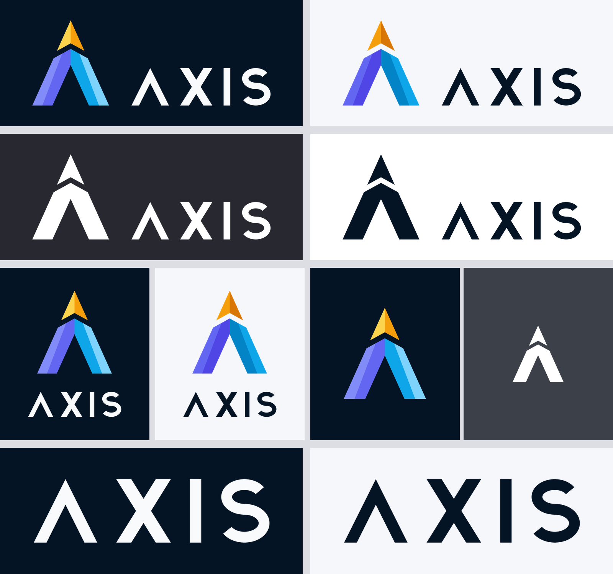

# AXIS — Logo System ("North Star")



## Concept
An evolution of the original peak-over-A mark, rebuilt as flat geometry:

- **The Summit (A):** a crossbar-less A drawn as a faceted prism. Its centre ridge is the implied **axis** that the whole day turns around.
- **The North Star (amber peak):** the detached peak is your goal. It's set slightly apart because a goal is always just ahead. Amber is the design system's *prestige / mastery* colour, so the one warm element is the thing you're working toward.
- **The gap:** the chevron of negative space between peak and summit is the distance you close each day. It doubles as a "level-up" mark (XP, mastery badges).
- **Facets:** each half has two tones: indigo on the left (planning and thought) and cyan on the right (action and flow). This gives depth without glow, gradients or bevels, so the mark holds up at 16 px and in one colour.

## Files
| File | Use |
|---|---|
| `axis-app-icon.svg` | iOS / store / desktop icon, full-bleed (the OS applies its own mask) |
| `axis-android-adaptive-foreground.svg` + `-background.svg` | Android adaptive icon layers (mark inside the 66% safe zone) |
| `axis-android-monochrome.svg` | Android 13+ themed icon and notification silhouette |
| `axis-favicon.svg` | Browser tab / 16–32 px (flat facets, mark scaled up 12%) |
| `axis-icon-on-dark.svg` / `-on-light.svg` | Symbol only, transparent background |
| `axis-icon-mono-white.svg` / `-mono-obsidian.svg` | One-colour symbol |
| `axis-logo-horizontal-*.svg` | Headers, desktop title bar, README, splash |
| `axis-logo-vertical-*.svg` | Auth screen, social, store graphics |
| `axis-wordmark-*.svg` | Custom geometric wordmark (outlined, needs no fonts) |
| `alternates/` | Other concepts: Dawn Summit, Rank, Dawn + Rank |
| `source/gen_final.py` | Regenerates every file from one geometry definition |

## Colour
| Role | On dark | On light |
|---|---|---|
| Peak (light / shade) | `#FCD34D` / `#F59E0B` | `#F59E0B` / `#D97706` |
| Left facet (outer / inner) | `#818CF8` / `#6366F1` | `#6366F1` / `#4F46E5` |
| Right facet (outer / inner) | `#7DD3FC` / `#0EA5E9` | `#0EA5E9` / `#0284C7` |
| Wordmark | `#F8FAFC` | `#051424` |
| Background | `#051424` Obsidian | `#F6F7FA` or white |

## Construction
- Built on a 512 grid. The symbol's legs lean 24° from vertical; the wordmark's A leans 27°, close enough to read as the same family.
- The peak gap is 24 / 364 of the symbol height (6.6%), so it stays open at 32 px.
- **Horizontal lockup:** the wordmark's cap height is 0.44 × the symbol height, and its baseline sits on the symbol's feet.
- **Clear space:** at least the height of the amber peak on every side.
- **Minimum size:** symbol 16 px (use the favicon file below 32 px); horizontal lockup 96 px wide.

## Don'ts
- Don't add glow, bloom, bevels or drop shadows to the mark. Glow is allowed only as a separate backdrop treatment on the splash screen or in marketing.
- Don't put the symbol inside an extra rounded square on app stores (the OS does that).
- Don't recolour the peak with anything other than amber, or use amber anywhere else in the mark.
- Don't stretch, rotate or re-space the wordmark, or set "AXIS" in another font next to the symbol.

## Exporting PNGs
```bash
vectorcraft-cli convert axis-app-icon.svg axis-app-icon-1024.png --scale 2
# or
inkscape axis-app-icon.svg --export-type=png --export-width=1024
```
